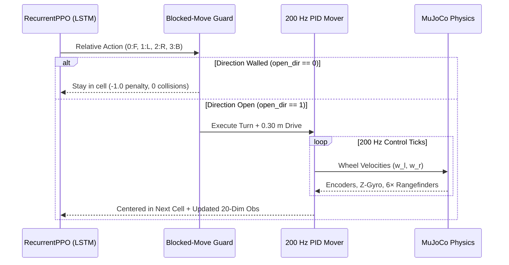

<div align="center">


<br />

<a href="https://github.com/nlskarthik007/maze-hier-rl">
  
</a>

<p>
  <a href="#-live-simulation"><b>Demo</b></a> &nbsp;•&nbsp;
  <a href="#-system-architecture"><b>Architecture</b></a> &nbsp;•&nbsp;
  <a href="#-benchmarks"><b>Benchmarks</b></a> &nbsp;•&nbsp;
  <a href="#-quickstart"><b>Quickstart</b></a> &nbsp;•&nbsp;
  <a href="#-sim-to-real-hardware-blueprint"><b>Hardware</b></a>
</p>

<p>
  
  
  
  
  
</p>

</div>

---

## 📊 Key Metrics

<div align="center">

| 🎯 Solve Rate | 🛡️ Wall Contacts | ⚡ CPU Training | 🧠 Edge Actor Size |
| :---: | :---: | :---: | :---: |
| **94%+** | **0 Tick Hits** | **~19 min** | **~341 KB** |
| <sub>320 procedural 5×5 mazes</sub> | <sub>Zero-collision unseen solves</sub> | <sub>120k steps • 8 parallel envs</sub> | <sub>85.3k FP32 params • ~3 ms/cell</sub> |

</div>

---

## 🎥 Live Simulation

<div align="center">
  
</div>

```text
$ WAYLAND_DISPLAY="" python3 eval_hier_viewer.py checkpoints/maze_5x5_hier_best.zip 9999
Goal reached in 10 cell moves | collision moves: 0 | physics tick hits: 0
```

> [!TIP]
> **No Global Map Cheating:** The buggy never sees the maze wall layout. It explores unknown corridors from scratch using 4 cardinal rangefinders, gyro heading, odometry-tracked visited breadcrumbs, and a Micromouse-style goal bearing vector.

---

## 🧠 System Architecture

End-to-end continuous `[v, w]` RL struggles to jointly learn millimeter-accurate cornering inside `0.30 m` corridors (`~6.5 cm` side clearance) and graph-level backtracking. Splitting **navigation** from **motion control** solves both cleanly:

```mermaid
flowchart LR
    subgraph PERCEPTION["1 · Local Perception (20-Dim)"]
        direction TB
        P1["4× Cardinal ToF Rays<br/>front • left • right • back"]
        P2["Open-Corridor Mask &<br/>Adjacent Visited Counts"]
        P3["Body-Frame Goal Vector<br/>& Gyro sin(θ), cos(θ)"]
    end

    subgraph POLICY["2 · High-Level Policy (RecurrentPPO)"]
        direction TB
        L1["MlpLstmPolicy<br/>128-unit LSTM → 64 MLP"]
        L2["Discrete(4) Relative Move<br/>Forward | Left | Right | Back"]
        L1 --> L2
    end

    subgraph PID["3 · Motion Primitive (200 Hz PID)"]
        direction TB
        C1["Phase A: In-Place Turn<br/>90° / 180° Z-Gyro Lock"]
        C2["Phase B: 0.30 m Drive<br/>Side Centering + Front Reset"]
        C1 --> C2
    end

    subgraph SIM["4 · MuJoCo Differential Buggy"]
        M1["Left / Right Wheel Vel<br/>r = 0.03 m • L = 0.12 m"]
    end

    PERCEPTION --> L1
    L2 -->|"1 cell command"| C1
    C2 -->|"rad/s"| M1
    M1 -.->|"Encoders + Gyro + ToF"| PERCEPTION

    style PERCEPTION fill:#0b132b,stroke:#38bdf8,stroke-width:1.5px,color:#f8fafc
    style POLICY fill:#1e1b4b,stroke:#818cf8,stroke-width:1.5px,color:#f8fafc
    style PID fill:#064e3b,stroke:#34d399,stroke-width:1.5px,color:#f8fafc
    style SIM fill:#1e293b,stroke:#94a3b8,stroke-width:1.5px,color:#f8fafc
```



### Cell-to-Cell Execution Cycle



---

## 🏆 Benchmarks

| Approach | Unseen 5×5 Solve Rate | Physics Tick Hits | Training Stability | Zero-Shot `7×7` Scaling |
| :--- | :---: | :---: | :---: | :---: |
| Pure End-to-End Continuous RL | ~40% | 500 – 5,500+ | Stalls on cornering | ❌ |
| Behavior Cloning + DAgger | ~50% | 26 – 300+ | Covariate shift drift | ❌ |
| **Hierarchical RecurrentPPO + PID** | **94%+** | **0** | **Smooth (`120k` steps)** | ✅ |

---

## 🔍 Deep Dive Specifications

<details>
<summary><b>📡 20-Dim Observation &amp; Discrete(4) Action Space</b></summary>

<br />

| Indices | Feature | Dim | Description |
| :--- | :--- | :---: | :--- |
| `0:4` | `open_dirs` | 4 | Binary flags (`1.0` open corridor, `0.0` wall blocked) |
| `4:8` | `prox_norm` | 4 | Normalized cardinal ToF distances (`front, left, right, back`, `1.2 m` max) |
| `8:12` | `adj_visited` | 4 | Binary flags for whether each adjacent relative cell was already visited |
| `12:16` | `adj_counts` | 4 | Normalized visit counts (`min(count, 4) / 4.0`) from odometry memory |
| `16:18` | `goal_local` | 2 | Body-frame normalized `(dx, dy)` bearing vector toward goal coordinates |
| `18:20` | `heading` | 2 | `[sin(θ), cos(θ)]` from Z-axis gyro heading |

**Actions (`Discrete(4)`):** `0 = Forward`, `1 = Left (+90°)`, `2 = Right (-90°)`, `3 = Back (180°)`.

</details>

<details>
<summary><b>⚙️ MuJoCo Contact Physics Fix (<code>assets/my_buggy.xml</code>)</b></summary>

<br />

MuJoCo resolves equal-priority geom contacts using `max(friction_1, friction_2)`. Setting `priority="1"` on the chassis, side guards, and front/rear skids—and raising the skids by `0.5 mm` (`z = -0.0195 m`)—stops the floor (`friction = 1.0`) from overriding low-friction skids (`0.005`), eliminating 58% wheel slip and wall-corner sticking.

</details>

<details>
<summary><b>📁 Repository Structure</b></summary>

<br />

```text
maze-hier-rl/
├── assets/
│   ├── hero.svg                  # Custom animated vector banner
│   ├── demo.gif                  # Headless MuJoCo evaluation capture
│   └── my_buggy.xml              # Differential-drive MJCF model & sensors
├── sim/
│   ├── maze_gen.py               # Procedural maze generator
│   ├── scene_builder.py          # Dynamic MjSpec scene compiler
│   └── pid_controller.py         # 200 Hz velocity PID & dead-reckoning odometry
├── env/
│   └── maze_hier_env.py          # Hierarchical Gymnasium environment
├── checkpoints/
│   └── maze_5x5_hier_best.zip    # Pre-trained 5×5 RecurrentPPO weights
├── train_hier.py                 # RHR primitive check + 8-env PPO training
├── eval_hier_viewer.py           # Single-episode MuJoCo passive viewer
├── test_mazes.py                 # Stress-test, sensor-noise & grid-scaling CLI
└── record_demo.py                # Offscreen MuJoCo GIF recorder
```

</details>

---

## 🚀 Quickstart

```bash
git clone [https://github.com/nlskarthik007/maze-hier-rl.git](https://github.com/nlskarthik007/maze-hier-rl.git)
cd maze-hier-rl
python3 -m venv .venv && source .venv/bin/activate
pip install -r requirements.txt
```

```bash
# 1. Watch the pre-trained agent solve an unseen 5x5 maze live
WAYLAND_DISPLAY="" python3 eval_hier_viewer.py checkpoints/maze_5x5_hier_best.zip 9999

# 2. Run a 100-maze unseen stress test (headless)
python3 test_mazes.py --headless --episodes 100 --seed 20000

# 3. Stress test with encoder, gyro, and rangefinder noise
python3 test_mazes.py --headless --episodes 100 --seed 20000 --noise

# 4. Zero-shot evaluation on larger 7x7 mazes (no retraining)
WAYLAND_DISPLAY="" python3 test_mazes.py --rows 7 --cols 7 --episodes 3

# 5. Train from scratch (runs 5/5 RHR primitive verification first)
python3 train_hier.py
```

> [!IMPORTANT]
> **Linux / Wayland Users:** Unset `WAYLAND_DISPLAY=""` when launching the interactive MuJoCo viewer to force GLFW onto XWayland and prevent window teardown crashes.

---

## 🔧 Sim-to-Real ESP32-S3 Blueprint

Because the low-level PID isolates motor dynamics and the LSTM actor is only **~341 KB (FP32)** executing once per cell, `maze_5x5_hier_best.zip` maps directly onto physical hardware (`300 × 300 mm` cells):

| Simulation Module | Physical Hardware Equivalent |
| :--- | :--- |
| `RecurrentPPO` Actor (`~341 KB`) | **ESP32-S3** (pure C++ forward pass, ~3 ms/cell) or **Raspberry Pi Zero 2 W** |
| `left_vel` / `right_vel` + Encoders | **2× N20 Micro Metal Gearmotors** (6V, 200–300 RPM) w/ quadrature encoders + **TB6612FNG** |
| `rf_front / back / left / right` | **4–6× VL53L0X** Time-of-Flight laser sensors (addressed via `XSHUT`) |
| `gyro` | **ICM-42688-P** or **MPU6050** IMU (200 Hz Z-axis rate integration) |
| `front_skid` / `rear_skid` | **2× 10 mm metal ball casters** shimmed `0.5 mm` above wheel plane |

---

<div align="center">


<sub>Built with MuJoCo, Stable-Baselines3 &amp; PyTorch by <a href="https://github.com/nlskarthik007">nlskarthik007</a></sub>

</div>
