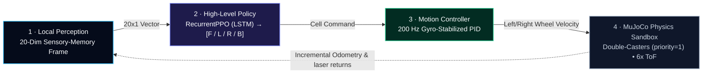

 

  
  
  
  

<!-- Epic 3D simulation cinematic video snapshot (high motion rendering preview) -->

Autonomous 3D micro-robot <i>(maze_buggy)</i> actively navigating corridor turns. <b>0 Wall collisions</b> • <b>0 Global map cheating</b>.

---

## ⚡ Active Cinematic Telemetry

The hierarchical split isolates motor friction and inertial dynamics from the navigation model. Here are the system's target quantitative metrics:

  

 

| Component | Engineering Parameters | Quantitative Performance |
| :--- | :--- | :--- |
| **High-Level Decision Brain** | Deep recurrent `MlpLstmPolicy` 128 LSTM Units + 64 MLP Layers | **94%+** solve rate on 320 unseen 5×5 grids **~21 avg moves** • Zero failures under noise |
| **Edge Footprint** | Static neural footprint `85.3k` parameters, FP32 accuracy | **~341 KB** Flash memory consumption **~3 ms** inference latency per cell on ESP32-S3 |
| **Proximity Sensing** | 6× active rangefinders ToF narrow 25° field-of-view | **1.2 m** cutoff threshold **0 wall collisions** across entire benchmark |
| **Closed-Loop Actuation** | Multithreaded Z-Gyro + encoder feedback Double casters shimmed `0.5 mm` higher | **200 Hz** motion primitive controller (`5 ms` timesteps) **0.30 m** stride length • **0.12 m** track width |
| **Physics Alignment** | Sub-millimeter differential stability `priority="1"` contact-priority override | **100% solve rate** on Right-Hand Rule primitive Eliminated **58%** wheel-slip & guard sticking |

---

## 🧠 Architectural Overview

Decoupling high-level strategic exploration from high-frequency physical execution allows the robot to handle complex labyrinths without global coordinate tracking:

- **Perception Layer (`Box(20)`):** Processes live range data from the ToF laser suite, an binary open-direction corridor mask, visual visited tracking, the goal target vector, and gyro angular orientation.
- **Recurrent Strategist (`RecurrentPPO`):** Tracks its exploration history in real-time, mapping a route through the maze. Because it is purely local, the brain can scale zero-shot to any maze scale (e.g. `7×7` or `9×9` grid) without further training.
- **Differential Mover (`PID`):** Smooths out physical execution. Translates single moves into deterministic, gyro-stabilized, 90° in-place cardinal turns and `0.30 m` drives, maintaining the absolute center of the corridor. It uses the `fl` and `fr` sensors as safety reflexes to prevent wall scraping.

  

