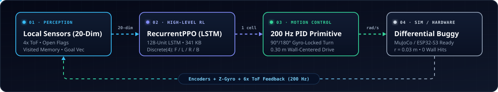

<div align="center">


<br />


<p>
  
  
  
  
</p>

</div>

---

## Quantitative Highlights

<div align="center">
  
</div>

<br />

| Category | Specification | Measured Value |
| :--- | :--- | :--- |
| **Navigation Performance** | Procedural 5×5 Solve Rate / Avg Moves | **94%+** / **~21 moves** (`10` moves on unseen test) |
| **Safety** | Wall Collision Tick Hits | **0** |
| **Training Efficiency** | Timesteps / CPU Wall-Clock Time | **120,000 steps** / **~19 min** (`8` envs, `320` mazes) |
| **Policy Interface** | Observation / Action Space | **20-dim** local vector / **Discrete(4)** (`F, L, R, B`) |
| **Low-Level Control** | PID Loop Rate / Cell Stride / Cruise | **200 Hz** (`5 ms` tick) / **0.30 m** / **0.62 m/s** lookahead |
| **Robot Kinematics** | Chassis / Wheels / Track Width | **120 × 96 mm** / **r = 0.03 m** / **L = 0.12 m** |
| **Sensor Suite** | Laser Rangefinders / Cutoff | **6× ToF** (`4` cardinal + `2` diagonal) / **1.2 m** |
| **Edge Deployment** | LSTM Actor Size / Latency | **~341 KB** (`85.3k` FP32 params) / **~3 ms/cell** on ESP32-S3 |

---

## Architecture

The system decouples **strategic maze exploration** from **precise physical motion** into a two-tier hierarchy. Separating decision-making from actuation eliminates wall-grazing failures, accelerates RL convergence, and allows the same policy to scale zero-shot to larger grids or deploy directly to embedded hardware.

<div align="center">
  
</div>

<br />

- **Local Perception (`20-Dim`):** Never receives the global wall map. At each cell, the robot builds a local vector from 4 cardinal rangefinders (`1.2 m` cutoff), binary open-corridor flags, odometry-tracked visited cell counts, a body-frame goal bearing vector, and its gyro heading.
- **High-Level Policy (`RecurrentPPO`):** A 128-unit LSTM evaluates the local state once per cell and outputs a relative `Discrete(4)` command (**Forward, Left, Right, or Back**), using its hidden state and breadcrumb memory to backtrack out of dead ends.
- **Low-Level Controller (`200 Hz PID + Lookahead`):** Filters blocked directions before motion starts. Valid moves run in two deterministic phases: a **PD-damped 90°/180° gyro-locked turn**, followed by a **`0.30 m` corridor drive** (`0.62 m/s` cruise) with side-wall centering, lookahead straightaway chaining, and front-wall-aware braking to cancel encoder drift.
- **Physics & Hardware Transfer:** Low-friction skids lifted `0.5 mm` (`z = -0.0195 m`) and side guards use contact priority tuning (`priority="1"`) so floor friction never brakes the drive wheels—mirroring ball casters on a physical **ESP32-S3 + VL53L0X + N20 encoder** build.

---

## Quick Setup & Running Guide

### 1. Clone & Create Virtual Environment
```bash
git clone https://github.com/nlskarthik007/RL_Maze_Buggy.git
cd RL_Maze_Buggy

python3 -m venv .venv
source .venv/bin/activate        # Linux / macOS
# .venv\Scripts\activate         # Windows PowerShell
```

### 2. Install Dependencies
Requires **Python 3.10+**. OpenGL/GLFW binaries are bundled automatically with `mujoco`:
```bash
pip install --upgrade pip
pip install mujoco gymnasium stable-baselines3 sb3-contrib torch numpy "imageio[ffmpeg]"
```

### 3. Run the Pre-Trained Agent (Interactive 3D Viewer)
- **Unseen 5×5 Maze with Lookahead Cruise-Through (`0.62 m/s`, `0` hits):**
  ```bash
  LC_ALL=C.UTF-8 python3 eval_hier_viewer.py checkpoints/maze_5x5_hier_best.zip 10001
  ```
- **Compare against stop-and-go cell stepping:**
  ```bash
  LC_ALL=C.UTF-8 python3 eval_hier_viewer.py checkpoints/maze_5x5_hier_best.zip 10001 --stop-and-go
  ```

### 4. Zero-Shot 7×7 Generalization Test (Headless)
Evaluate the 5×5-trained checkpoint on an unseen 7×7 maze with dead-end backtracking ( you can change the rows and columns to test for other dimension mazes):
```bash
python3 -c "
from sb3_contrib import RecurrentPPO
from env.maze_hier_env import MazeHierEnv
from eval_hier_viewer import run_smooth_episode

model = RecurrentPPO.load('checkpoints/maze_5x5_hier_best.zip')
env = MazeHierEnv(rows=7, cols=7, pool_size=1, base_seed=7002, max_moves=120, noise_enabled=False)
obs, _ = env.reset(seed=7002)
run_smooth_episode(env, model, obs, max_moves=120)
"
```

### 5. Train from Scratch (Optional)
```bash
python3 train_hier.py
```

### Troubleshooting (Linux / Wayland & Headless)
- **`GLFWError: Wayland: Failed to connect to display`:** Unset `WAYLAND_DISPLAY` so GLFW falls back to X11/XWayland:
  ```bash
  env -u WAYLAND_DISPLAY python3 eval_hier_viewer.py checkpoints/maze_5x5_hier_best.zip 10001
  ```
- **Headless / SSH Environments:** Render offscreen without a display by setting `MUJOCO_GL=egl` (GPU) or `MUJOCO_GL=osmesa` (CPU).

<div align="center">
  
</div>
